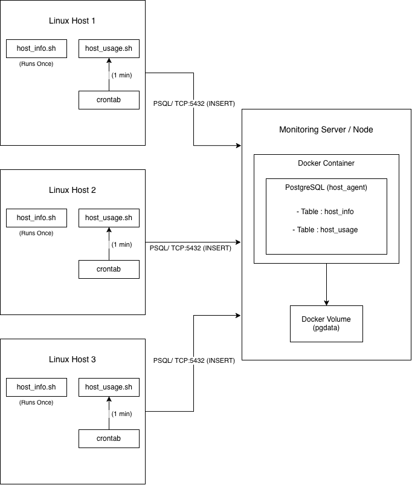

# Linux Cluster Monitoring Agent

## Introduction
The Linux Cluster Monitoring Agent is a solution built to help infrastructure administrators and Linux Cluster Administration (LCA) teams track hardware specifications and real-time resource utilization across multiple Linux nodes. By deploying automated Bash agents onto each host machine, the system gathers static hardware metadata alongside minute-by-minute performance metrics—including free memory, CPU idle/kernel percentages, disk I/O, and available storage. All collected telemetry is persisted centrally into a containerized PostgreSQL database, enabling teams to monitor cluster health, detect resource bottlenecks, and plan capacity upgrades through SQL analytics. The project leverages **Bash** for data collection, **Docker** for database provisioning, **PostgreSQL** for relational storage, **Linux Crontab** for automated scheduling, and **Git/GitHub** following GitFlow conventions for version control.

---

## Quick Start

1. **Provision, start and stop the PostgreSQL container:**
   ```bash
   ./scripts/psql_docker.sh create db_username db_password
   ./scripts/psql_docker.sh start
   ./scripts/psql_docker.sh stop 
   ```

2. **Initialize the `host_agent` database and schema tables:**
   ```bash
   psql -h localhost -U postgres -c "CREATE DATABASE host_agent;"
   psql -h localhost -U postgres -d host_agent -f sql/ddl.sql
   ```

3. **Collect and insert static host hardware specifications (run once per node):**
   ```bash
   ./scripts/host_info.sh "localhost" 5432 "host_agent" "postgres" "your_password"
   ```

4. **Collect and insert live resource usage metrics:**
   ```bash
   bash ./scripts/host_usage.sh "localhost" 5432 "host_agent" "postgres" "your_password"
   ```

5. **Automate metric collection every minute via `crontab`:**
   ```bash
   crontab -e
   # Add the following entry (update path and password accordingly):
   * * * * * bash /home/rocky/dev/jarvis_data_eng_KeeranCheliyan/linux_sql/scripts/host_usage.sh localhost 5432 host_agent postgres your_password > /tmp/host_usage.log 2>&1
   ```

---

## Implementation

### Architecture
The cluster consists of multiple Linux worker hosts, each running local Bash monitoring agents (`host_info.sh` and `host_usage.sh`). Every node connects over TCP/IP (port `5432`) to persist telemetry into a central PostgreSQL instance hosted inside a Docker container.



### Scripts

* **`scripts/psql_docker.sh`**: Automates the lifecycle of the PostgreSQL Docker container (`create`, `start`, and `stop`), ensuring data persistence via a named Docker volume (`pgdata`).
  ```bash
  ./scripts/psql_docker.sh start|stop|create [db_username] [db_password]
  ```

* **`scripts/host_info.sh`**: Parses static machine hardware specifications using `lscpu` and `/proc/meminfo` and inserts a single node profile into the `host_info` table.
  ```bash
  ./scripts/host_info.sh psql_host psql_port db_name psql_user psql_password
  ```

* **`scripts/host_usage.sh`**: Captures dynamic server metrics using `vmstat` and `df`, resolves the node's foreign key via hostname lookup, and appends a timestamped record to `host_usage`.
  ```bash
  bash scripts/host_usage.sh psql_host psql_port db_name psql_user psql_password
  ```

* **`crontab`**: Schedules `host_usage.sh` to run unattended at one-minute intervals and redirects standard output and error streams to `/tmp/host_usage.log` for troubleshooting.
  ```bash
  * * * * * bash /path/to/linux_sql/scripts/host_usage.sh localhost 5432 host_agent postgres your_password > /tmp/host_usage.log 2>&1
  ```
---

## Database Modeling

### `host_info`
Stores static hardware specifications for each monitored Linux host.

| Column | Data Type | Constraint | Description |
| :--- | :--- | :--- | :--- |
| `id` | `SERIAL` | `PRIMARY KEY` | Auto-incrementing unique identifier for each host |
| `hostname` | `VARCHAR` | `UNIQUE NOT NULL` | Fully qualified domain name (FQDN) of the server |
| `cpu_number` | `INT2` | `NOT NULL` | Total number of logical CPU cores |
| `cpu_architecture` | `VARCHAR` | `NOT NULL` | Processor architecture (e.g., `x86_64`) |
| `cpu_model` | `VARCHAR` | `NOT NULL` | Detailed CPU model name |
| `cpu_mhz` | `FLOAT8` | `NOT NULL` | CPU clock speed in MHz |
| `l2_cache` | `INT4` | `NOT NULL` | L2 cache size in KB |
| `total_mem` | `INT4` | `NOT NULL` | Total physical RAM in KB |
| `timestamp` | `TIMESTAMP` | `NOT NULL` | UTC timestamp when the host was registered |

### `host_usage`
Stores time-series resource utilization snapshots linked to `host_info`.

| Column | Data Type | Constraint | Description |
| :--- | :--- | :--- | :--- |
| `timestamp` | `TIMESTAMP` | `NOT NULL` | UTC timestamp of the metric snapshot |
| `host_id` | `SERIAL` | `FOREIGN KEY` | References `host_info(id)` to identify the source node |
| `memory_free` | `INT4` | `NOT NULL` | Available free memory in MB |
| `cpu_idle` | `INT2` | `NOT NULL` | Percentage of idle CPU time |
| `cpu_kernel` | `INT2` | `NOT NULL` | Percentage of CPU time spent running kernel processes |
| `disk_io` | `INT4` | `NOT NULL` | Number of active disk I/O operations in progress |
| `disk_available` | `INT4` | `NOT NULL` | Available root filesystem space in MB |

---

## Testing
* **DDL & Database Setup**: Executed `sql/ddl.sql` against a fresh `host_agent` database and verified table schemas, data types, primary/foreign keys, and unique constraints using `\dt` and `\d` inside `psql`.
* **Bash Scripts (`psql_docker.sh`, `host_info.sh`, `host_usage.sh`)**: Verified CLI argument validation by passing invalid parameter counts (confirming exit code `1`) and tested valid executions end-to-end (confirming exit code `0` and `INSERT 0 1` responses).
* **Crontab & Queries**: Monitored `/tmp/host_usage.log` over multiple minutes to confirm automated inserts, then executed `sql/queries.sql` against multi-row test data to validate window functions and aggregation accuracy.

---

## Deployment
* **Database Layer**: Deployed PostgreSQL inside a Docker container managed by `psql_docker.sh`, mounting a persistent volume (`pgdata`) so telemetry survives container restarts.
* **Monitoring Agent**: Deployed `host_info.sh` (one-time initialization) and scheduled `host_usage.sh` via Linux `crontab` to execute automatically every minute.
* **Source Control**: Managed development using GitFlow—implementing each feature on an isolated feature branch, merging into `develop` upon testing, and tagging production releases on `main`.

---

## Improvements
1. **Dynamic Hardware Updates**: Update `host_info.sh` to support `ON CONFLICT (hostname) DO UPDATE` so hardware upgrades (such as adding RAM or vCPUs to cloud instances) automatically refresh existing records without manual database intervention.
2. **Real-Time Alerting**: Integrate a lightweight alerting hook (e.g., Slack webhook or email notification) triggered when CPU idle drops below a critical threshold or when a host misses consecutive heartbeat intervals.
3. **Log Rotation & Data Retention**: Implement `logrotate` for `/tmp/host_usage.log` and add an automated archival/partitioning policy in PostgreSQL to prevent unbounded table growth over long-term monitoring.

